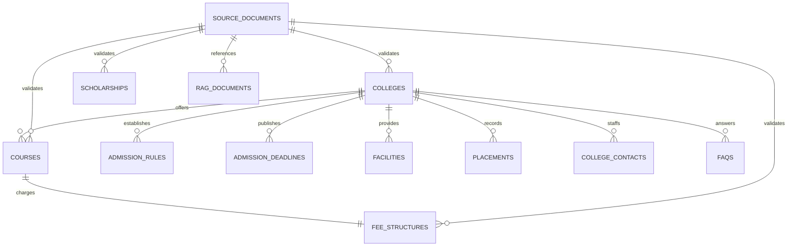

# DKTE College Calling Agent Dataset (RAG & Relational DB Ready)

A comprehensive, production-grade JSON dataset designed for AI-powered college enquiry calling agents and conversational voicebots. Based on verified institutional facts from **DKTE Society's Textile & Engineering Institute (An Autonomous Institute), Ichalkaranji, Maharashtra, India** ([https://www.dkte.ac.in/](https://www.dkte.ac.in/)).

---

## 1. Dataset Overview

This dataset powers an LLM with Retrieval-Augmented Generation (RAG) and phone-calling voice infrastructure (e.g., ElevenLabs / LiveKit / Twilio / Vapi / Bland.ai) to handle inbound/outbound calls from prospective students and parents.

### Key Highlights
- **100% Relational Integrity**: Uses RFC 4122 v4 deterministic UUIDs across all foreign keys.
- **Strict Verification Tagging**: Facts derived from official DTE, FRA, MahaDBT, and DKTE records are tagged `VERIFIED`. Forward-looking testing data is marked `SYNTHETIC_TEST_DATA`. Missing or unknown items are marked `NOT_VERIFIED` or `null`.
- **Dual RAG & Relational Compatibility**:
  - Direct import into relational databases like **PostgreSQL** (supports relational queries for exact fee calculation, intake counts, contacts).
  - Native ingestion into vector databases like **ChromaDB**, **Pinecone**, or **Qdrant** using chunked documents with rich metadata in `rag_documents.json`.
- **Voice Agent Optimization**: Includes `short_answer_speech` tailored for text-to-speech (TTS) engines, realistic `call_scenarios.json` with detected intents, and strict human-handoff triggers.

---

## 2. File Manifest

| File Name | Records | Description & Primary Entity |
| :--- | :---: | :--- |
| [`colleges.json`](file:///c:/Users/TEJAS%20BABAR/Desktop/Projects/DataSet%20College/colleges.json) | 1 | Master college profile (DTE Code: 6222 / 6225, NAAC A+, Shivaji University, 14.5-acre campus). |
| [`courses.json`](file:///c:/Users/TEJAS%20BABAR/Desktop/Projects/DataSet%20College/courses.json) | 22 | 12 B.Tech UG branches, 7 PG courses (M.Tech, MBA, MCA), and 3 Diploma courses with approved intakes. |
| [`fee_structures.json`](file:///c:/Users/TEJAS%20BABAR/Desktop/Projects/DataSet%20College/fee_structures.json) | 22 | FRA-approved Tuition, Development, Exam, Category-wise fees (Open, OBC, SC, ST, TFWS, Girls Free Education). |
| [`admission_rules.json`](file:///c:/Users/TEJAS%20BABAR/Desktop/Projects/DataSet%20College/admission_rules.json) | 5 | Eligibility criteria, 45%/40% PCM marks rules, MHT-CET/JEE Main mandates, and CAP quotas (65% MS, 15% AI, 20% IL). |
| [`admission_deadlines.json`](file:///c:/Users/TEJAS%20BABAR/Desktop/Projects/DataSet%20College/admission_deadlines.json) | 4 | CAP round schedules (Registration, Scrutiny, Choice Filling, Allotment, Confirmation) + synthetic test cycles. |
| [`scholarships.json`](file:///c:/Users/TEJAS%20BABAR/Desktop/Projects/DataSet%20College/scholarships.json) | 7 | MahaDBT schemes: EBC (50%), Girls Free Higher Education (100%), Panjabrao Deshmukh Hostel Allowance, SC/ST, TFWS. |
| [`facilities.json`](file:///c:/Users/TEJAS%20BABAR/Desktop/Projects/DataSet%20College/facilities.json) | 8 | Boys hostel (50 seats), Girls hostel (324 seats), central mess, 65k-volume library, CoE textile pilot plants, Wi-Fi. |
| [`placements.json`](file:///c:/Users/TEJAS%20BABAR/Desktop/Projects/DataSet%20College/placements.json) | 3 | 3-year historical placement stats (82.9% placed, ₹4.85 LPA average, ₹16.50 LPA highest, top IT and textile recruiters). |
| [`college_contacts.json`](file:///c:/Users/TEJAS%20BABAR/Desktop/Projects/DataSet%20College/college_contacts.json) | 9 | Official admissions helplines (Dr. Ghatage, Dr. Patil), TPO officers, Student Section, Accounts, Toll-Free: 1800 843 1300. |
| [`documents_required.json`](file:///c:/Users/TEJAS%20BABAR/Desktop/Projects/DataSet%20College/documents_required.json) | 14 | Checklist of mandatory documents (MHT-CET scorecard, Leaving Certificate, Domicile, Caste Validity, NCL, Income). |
| [`faqs.json`](file:///c:/Users/TEJAS%20BABAR/Desktop/Projects/DataSet%20College/faqs.json) | 55 | 55 natural student & parent telephone enquiries with both concise spoken answers and comprehensive institutional facts. |
| [`source_documents.json`](file:///c:/Users/TEJAS%20BABAR/Desktop/Projects/DataSet%20College/source_documents.json) | 11 | Source traceability registry linking official URLs, publication dates, and verification timestamps. |
| [`rag_documents.json`](file:///c:/Users/TEJAS%20BABAR/Desktop/Projects/DataSet%20College/rag_documents.json) | 9 | Dense, semantically chunked text records with flat metadata for ChromaDB / vector retrieval. |
| [`call_scenarios.json`](file:///c:/Users/TEJAS%20BABAR/Desktop/Projects/DataSet%20College/call_scenarios.json) | 7 | Real-world call dialogues (OBC fees, Girls free education, DSE lateral entry, missing validity, safe fallbacks). |

---

## 3. Entity-Relationship Architecture



---

## 4. Ingesting into ChromaDB for Vector RAG

```python
import json
import chromadb
from chromadb.utils import embedding_functions

client = chromadb.PersistentClient(path="./chroma_db")
embedding_func = embedding_functions.DefaultEmbeddingFunction()
collection = client.get_or_create_collection(
    name="dkte_admissions_knowledge",
    embedding_function=embedding_func
)

with open("rag_documents.json", "r", encoding="utf-8") as f:
    chunks = json.load(f)

ids = [c["chunk_id"] for c in chunks]
documents = [c["content"] for c in chunks]
metadatas = []
for c in chunks:
    meta = c["metadata"].copy()
    meta["title"] = c["title"]
    meta["doc_type"] = c["doc_type"]
    meta["tags"] = ", ".join(meta["tags"]) # Chroma requires scalar metadata
    metadatas.append(meta)

collection.add(ids=ids, documents=documents, metadatas=metadatas)
print(f"Successfully ingested {len(ids)} knowledge chunks into ChromaDB.")
```

---

## 5. PostgreSQL Relational Schema (DDL)

```sql
CREATE EXTENSION IF NOT EXISTS "uuid-ossp";

CREATE TABLE colleges (
    college_id UUID PRIMARY KEY,
    name VARCHAR(255) NOT NULL,
    short_name VARCHAR(100),
    institute_code_dte VARCHAR(20) NOT NULL,
    type VARCHAR(100),
    university_affiliation VARCHAR(150),
    address TEXT,
    city VARCHAR(100),
    district VARCHAR(100),
    state VARCHAR(100),
    pin_code VARCHAR(20),
    website VARCHAR(255),
    establishment_year INT,
    verification_status VARCHAR(50)
);

CREATE TABLE courses (
    course_id UUID PRIMARY KEY,
    college_id UUID REFERENCES colleges(college_id),
    course_name VARCHAR(255) NOT NULL,
    degree_level VARCHAR(50) NOT NULL,
    branch VARCHAR(100) NOT NULL,
    duration VARCHAR(50),
    duration_semesters INT,
    intake_seats INT NOT NULL,
    study_mode VARCHAR(50),
    course_code VARCHAR(50),
    academic_year VARCHAR(20),
    verification_status VARCHAR(50)
);

CREATE TABLE fee_structures (
    fee_id UUID PRIMARY KEY,
    course_id UUID REFERENCES courses(course_id),
    academic_year VARCHAR(20) NOT NULL,
    tuition_fees NUMERIC(10, 2) NOT NULL,
    development_fees NUMERIC(10, 2) NOT NULL,
    examination_fees NUMERIC(10, 2),
    other_annual_fees NUMERIC(10, 2),
    caution_money_deposit_one_time NUMERIC(10, 2),
    total_annual_fee_open NUMERIC(10, 2) NOT NULL,
    total_programme_cost_open NUMERIC(10, 2),
    hostel_fees_annual NUMERIC(10, 2),
    mess_charges_annual NUMERIC(10, 2),
    category_wise_fees JSONB,
    verification_status VARCHAR(50)
);
```

---

## 6. AI Calling Agent Operating Directives

1. **Category Distinction**: Always prompt the caller for their quota/category (Open, OBC, EBC, SC, ST, TFWS, or Girl Student) before quoting fees to provide accurate payable amounts.
2. **Safe Fallback**: If an enquiry involves an unannounced schedule or future cutoff dates (marked `NOT_VERIFIED` or pending official notification), politely inform the caller that official dates have not yet been released and provide the DTE toll-free helpline (`1800 843 1300`).
3. **Mandatory Human Handoff**: Instantly offer warm transfer to admissions officer **Prof. (Dr.) A. K. Ghatage (+91 7083253672)** or student section **Mr. Rohit Potdar (+91 7385666811)** if the caller encounters document discrepancies (e.g. missing Caste Validity) or requests hostel reservations.
